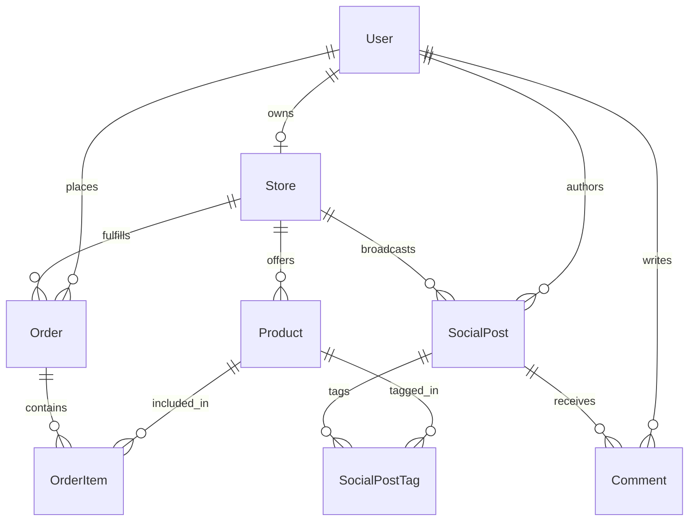

# Data Model Specification: Greeny Eco-Commerce Platform (`greeny_eco_db`)

**Feature**: `001-eco-commerce-platform` | **Date**: 2026-10-17

---

## 1. Entity Relationship Diagram (ERD)



---

## 2. Model Definitions

### 1. `User`
Represents buyers, store owners, creators, and platform administrators.

| Field | Type | Attributes | Description |
| :--- | :--- | :--- | :--- |
| `id` | `String` | `@id @default(uuid())` | Unique user identifier (matches Supabase Auth UID) |
| `email` | `String` | `@unique` | User email address |
| `phone` | `String?` | `@unique` | Mobile phone number (for SMS login) |
| `name` | `String` | | Full name or display moniker |
| `role` | `UserRole` | `@default(BUYER)` | Role: `BUYER`, `SELLER`, `ADMIN` |
| `avatarUrl` | `String?` | | Profile avatar URL in Supabase Storage |
| `walletBalance` | `Decimal` | `@default(0.00) @db.Decimal(12,2)` | Greeny Wallet balance in THB |
| `carbonSavedKg` | `Decimal` | `@default(0.00) @db.Decimal(10,2)` | Lifetime carbon offset metric (kg CO₂e) |
| `followersCount`| `Int` | `@default(0)` | Social follower count |
| `followingCount`| `Int` | `@default(0)` | Social following count |
| `settingsJson` | `Json?` | | User preferences (language, notification toggles, shipping address) |
| `createdAt` | `DateTime` | `@default(now())` | Account creation timestamp |
| `updatedAt` | `DateTime` | `@updatedAt` | Last modification timestamp |

---

### 2. `Store`
Represents verified seller stores and agricultural cooperatives.

| Field | Type | Attributes | Description |
| :--- | :--- | :--- | :--- |
| `id` | `String` | `@id @default(uuid())` | Unique store identifier |
| `ownerId` | `String` | `@unique` | Reference to owner `User.id` |
| `storeName` | `String` | | Official store name (e.g., `สวนดินดี ออร์แกนิค`) |
| `corporateTaxId`| `String?` | | 13-digit Thai corporate or citizen tax ID |
| `taxAddressJson`| `Json` | | Legal tax invoice address (เลขที่, แขวง/ตำบล, เขต/อำเภอ, จังหวัด, รหัสไปรษณีย์) |
| `storeAddressJson`| `Json` | | Physical fulfillment hub address |
| `phone` | `String` | | Merchant customer contact number |
| `payoutMethod` | `PayoutMethod` | `@default(PROMPTPAY)` | `CARD`, `BANK`, `PROMPTPAY` |
| `payoutAccount` | `String` | | PromptPay mobile/ID or bank account number |
| `isMallVerified`| `Boolean` | `@default(false)` | Verified Green Mall badge status |
| `sustainabilityScore`| `Decimal` | `@default(98.50) @db.Decimal(5,2)` | Store sustainability performance rating |
| `createdAt` | `DateTime` | `@default(now())` | Store creation timestamp |

---

### 3. `Product`
Represents an eco-friendly agricultural packaging or lifestyle product.

| Field | Type | Attributes | Description |
| :--- | :--- | :--- | :--- |
| `id` | `String` | `@id @default(uuid())` | Unique product identifier |
| `storeId` | `String` | | Reference to seller `Store.id` |
| `name` | `String` | | Product title (e.g., `ผักตบชวาอบแห้งกันกระแทก`) |
| `description` | `String` | `@db.Text` | Detailed product narrative |
| `materialType` | `MaterialType` | | Raw fiber category (`HYACINTH`, `RICE_STRAW`, `MYCELIUM`, etc.) |
| `usageInfo` | `String?` | `@db.Text` | Application and packaging packing guide |
| `warningInfo` | `String?` | `@db.Text` | Moisture and storage warnings |
| `nutritionInfo`| `String?` | `@db.Text` | Fiber breakdown / biodegradation specs |
| `hashtags` | `String[]` | | Search hashtags (e.g., `["#ผักตบชวา", "#กันกระแทก"]`) |
| `images` | `String[]` | | Array of image URLs in `product-media` bucket |
| `retailPrice` | `Decimal` | `@db.Decimal(10,2)` | Single-unit retail price (`ขายปลีก`) in THB |
| `wholesaleTiersJson`| `Json` | | Tiered pricing rules (e.g., `[{minQty: 3, unitPrice: 45, discountPct: 10}]`) |
| `stock` | `Int` | `@default(100)` | Available inventory units |
| `size` | `String?` | | Dimensions (e.g., `1 กก.`, `13x17x7 cm`, `500 กรัม`) |
| `flashSaleType` | `FlashSaleType?` | | `HOURLY`, `DAILY`, `SPECIAL`, `CLEARANCE` |
| `flashSaleEndsAt`| `DateTime?` | | Countdown target timestamp |
| `isBuyOneGetOne`| `Boolean` | `@default(false)` | BOGO promo flag (`ซื้อ 1 แถม 1`) |
| `isFreeShipping`| `Boolean` | `@default(false)` | Free shipping badge flag (`ส่งฟรีทั่วไทย`) |
| `certifications`| `CertificationType[]` | | Array of standard badges (`ORGANIC`, `GAP_GMP`, `OTOP`, etc.) |
| `certDocUrl` | `String?` | | Uploaded certificate URL in `certification-docs` |
| `soldCount` | `Int` | `@default(0)` | Sales counter (`ขายแล้ว 1พัน+`) |
| `rating` | `Decimal` | `@default(5.00) @db.Decimal(3,2)` | Star rating score (0.00 to 5.00) |
| `carbonOffsetKg`| `Decimal` | `@default(0.45) @db.Decimal(6,2)` | Carbon offset per unit sold (kg CO₂e) |
| `createdAt` | `DateTime` | `@default(now())` | Product creation timestamp |

---

### 4. `Order`
Represents an e-commerce purchase transaction.

| Field | Type | Attributes | Description |
| :--- | :--- | :--- | :--- |
| `id` | `String` | `@id @default(uuid())` | Unique order identifier (e.g., `ORD-20261017-XXXX`) |
| `buyerId` | `String` | | Reference to purchasing `User.id` |
| `storeId` | `String` | | Reference to fulfilling `Store.id` |
| `itemsJson` | `Json` | | Snapshot of purchased line items, quantities, and applied tiers |
| `shippingAddressJson`| `Json` | | Delivery recipient, address, and contact number |
| `shippingCarrier`| `String` | | Logistics provider (`ขนส่ง 1: Flash`, `ขนส่ง 2: Kerry`, `ขนส่ง 3: ThaiPost`) |
| `shippingFee` | `Decimal` | `@default(0.00) @db.Decimal(10,2)` | Shipping cost in THB |
| `discountAmount`| `Decimal` | `@default(0.00) @db.Decimal(10,2)` | Voucher discount amount in THB |
| `totalAmount` | `Decimal` | `@db.Decimal(10,2)` | Final order total in THB |
| `sellingFee` | `Decimal` | `@default(0.00) @db.Decimal(10,2)` | Platform commission fee (PDF Page 55) |
| `adFee` | `Decimal` | `@default(0.00) @db.Decimal(10,2)` | Campaign advertisement deduction |
| `affiliateUserId`| `String?` | | ID of eco-creator affiliate referrer |
| `affiliateFee` | `Decimal` | `@default(0.00) @db.Decimal(10,2)` | Affiliate commission earned |
| `paymentMethod` | `PaymentMethod` | | `CREDIT_CARD`, `BANK_TRANSFER`, `PROMPTPAY` |
| `status` | `OrderStatus` | `@default(TO_PAY)` | `TO_PAY`, `TO_SHIP`, `SHIPPED`, `TO_RECEIVE`, `COMPLETED`, `CANCELLED` |
| `cancelReason` | `String?` | | Buyer/Seller cancellation rationale |
| `trackingCode` | `String?` | | Carrier parcel tracking number |
| `createdAt` | `DateTime` | `@default(now())` | Order placement timestamp |

---

### 5. `SocialPost`
Represents livestream broadcasts, UGC photo/video reviews, and cross-platform reviews.

| Field | Type | Attributes | Description |
| :--- | :--- | :--- | :--- |
| `id` | `String` | `@id @default(uuid())` | Unique post identifier |
| `authorId` | `String` | | Reference to author `User.id` |
| `storeId` | `String?` | | Associated `Store.id` (if official live broadcast) |
| `postType` | `PostType` | | `LIVE`, `REVIEW_PHOTO`, `REVIEW_VIDEO`, `EXTERNAL_REVIEW` |
| `title` | `String` | | Stream or review headline |
| `caption` | `String` | `@db.Text` | Review text narrative |
| `mediaUrls` | `String[]` | | Array of photos, videos, or HLS stream URLs |
| `externalSourceUrl`| `String?` | | Source link for external social posts (e.g., Lemon8 post) |
| `externalPlatform`| `String?` | | External platform tag (`Lemon8`, `TikTok`, `Instagram`) |
| `visibility` | `Visibility` | `@default(PUBLIC)` | `PUBLIC`, `FOLLOWERS`, `PRIVATE` |
| `likesCount` | `Int` | `@default(0)` | Heart reaction count |
| `viewsCount` | `Int` | `@default(0)` | Live viewers or post views |
| `taggedProductIds`| `String[]` | | Array of featured `Product.id`s ("กำลังไลฟ์" items) |
| `createdAt` | `DateTime` | `@default(now())` | Post creation timestamp |

---

### 6. `Comment`
Represents community interactions on review posts and live streams.

| Field | Type | Attributes | Description |
| :--- | :--- | :--- | :--- |
| `id` | `String` | `@id @default(uuid())` | Unique comment identifier |
| `postId` | `String` | | Reference to `SocialPost.id` |
| `authorId` | `String` | | Reference to `User.id` |
| `content` | `String` | `@db.Text` | Comment body text |
| `parentCommentId`| `String?` | | Self-referencing ID for threaded replies |
| `likesCount` | `Int` | `@default(0)` | Upvote count |
| `createdAt` | `DateTime` | `@default(now())` | Comment timestamp |

---

### 7. `ChatMessage`
Represents AI consultation and merchant support messages.

| Field | Type | Attributes | Description |
| :--- | :--- | :--- | :--- |
| `id` | `String` | `@id @default(uuid())` | Unique message identifier |
| `sessionId` | `String` | | Chat session or store thread identifier |
| `senderRole` | `ChatSenderRole`| | `BUYER`, `SELLER`, `AI`, `SUPPORT` |
| `messageText` | `String` | `@db.Text` | Original user or agent input |
| `translatedText`| `String?` | `@db.Text` | Bilingual translation (TH ↔ EN) |
| `recommendedProductIds`| `String[]` | | Product IDs recommended by AI |
| `createdAt` | `DateTime` | `@default(now())` | Message timestamp |

---

## 3. Enumerations

```prisma
enum UserRole {
  BUYER
  SELLER
  ADMIN
}

enum PayoutMethod {
  CARD
  BANK
  PROMPTPAY
}

enum MaterialType {
  HYACINTH      // ผักตบชวา
  RICE_STRAW    // ฟางข้าว
  MYCELIUM      // เส้นใยเห็ด
  BAGASSE       // ชานอ้อย
  CORNSTARCH    // แป้งข้าวโพด
  BANANA_STEM   // ก้านกล้วย
  COCONUT_COIR  // ขุยมะพร้าว
  HONEYCOMB     // กระดาษรังผึ้ง
  POPCORN       // โฟมข้าวโพดป๊อป
}

enum FlashSaleType {
  HOURLY
  DAILY
  SPECIAL
  CLEARANCE
}

enum CertificationType {
  DISTRICT_AGRI  // สำนักงานเกษตรอำเภอ
  ORGANIC        // มาตรฐานเกษตรอินทรีย์ (Organic Thailand)
  OTOP           // มาตรฐานผลิตภัณฑ์ชุมชน (มผช.)
  FDA            // สำนักงานคณะกรรมการอาหารและยา (อย.)
  GAP_GMP        // GAP / GMP
  HACCP          // HACCP
  OTHER          // อื่นๆ ระบุ
}

enum PaymentMethod {
  CREDIT_CARD
  BANK_TRANSFER
  PROMPTPAY
}

enum OrderStatus {
  TO_PAY       // ต้องชำระเงิน
  TO_SHIP      // เตรียมจัดส่ง (ต้องจัดส่ง)
  SHIPPED      // จัดส่งแล้ว
  TO_RECEIVE   // ต้องได้รับ
  COMPLETED    // สำเร็จแล้ว
  CANCELLED    // ยกเลิกแล้ว
  REFUNDED     // คืนเงิน/คืนสินค้า
}

enum PostType {
  LIVE
  REVIEW_PHOTO
  REVIEW_VIDEO
  EXTERNAL_REVIEW
}

enum Visibility {
  PUBLIC
  FOLLOWERS
  PRIVATE
}

enum ChatSenderRole {
  BUYER
  SELLER
  AI
  SUPPORT
}
```
