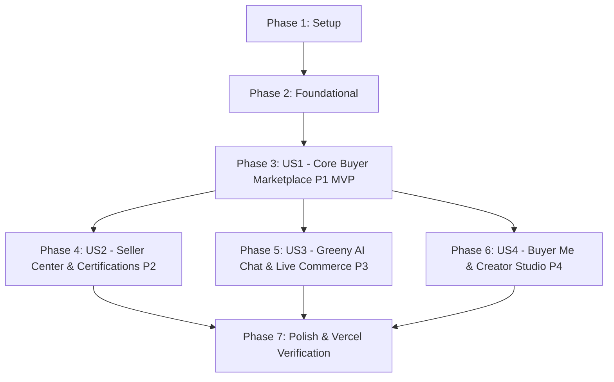

# Tasks: Greeny Eco-Commerce Platform

**Input**: Design documents from `/specs/001-eco-commerce-platform/` ([spec.md](./spec.md), [plan.md](./plan.md), [data-model.md](./data-model.md), [research.md](./research.md), [contracts/](./contracts/))

**Prerequisites**: [plan.md](./plan.md), [spec.md](./spec.md), [data-model.md](./data-model.md), [contracts/schema.prisma](./contracts/schema.prisma)

**Organization**: Tasks are grouped by phase and user story to enable independent implementation, incremental delivery, and testability.

## Format: `[ID] [P?] [Story] Description`
- **[P]**: Can run in parallel (different files, no blocking dependencies)
- **[Story]**: Mapped user story (`US1`, `US2`, `US3`, `US4`) or phase identifier (`SETUP`, `FOUNDATION`, `POLISH`)
- Includes exact file paths for each action

---

## Phase 1: Setup (Shared Infrastructure)

**Purpose**: Project initialization, dependency installation, and design token configuration.

- [x] T001 [SETUP] Initialize Next.js 15 App Router project with TypeScript in root workspace
- [x] T002 [SETUP] Install dependencies: `prisma`, `@prisma/client`, `@supabase/supabase-js`, `lucide-react`, `canvas-confetti`, `clsx`, `tailwind-merge`
- [x] T003 [P] [SETUP] Port design tokens from `./econfushion/econ phase 4/stitch_greeny_eco_e_commerce_platform/eco_natural_commerce/DESIGN.md` into `tailwind.config.ts` (colors, fonts, radii, spacing)
- [x] T004 [P] [SETUP] Configure Google Fonts (`Plus Jakarta Sans`, `Be Vietnam Pro`, `Material Symbols Outlined`) in `src/app/layout.tsx` and `src/app/globals.css`
- [x] T005 [P] [SETUP] Configure Vercel deployment settings in `vercel.json` and create `.env.example` with Supabase/Prisma connection variables

---

## Phase 2: Foundational (Prisma Schema, Supabase Pooling & Seed Data)

**Purpose**: Database models, connection pooler, seed data, and storage buckets.

**⚠️ CRITICAL**: Blocks all user stories until database models and seed data are ready.

- [x] T006 [FOUNDATION] Copy and setup Prisma schema from `contracts/schema.prisma` to `prisma/schema.prisma` with PgBouncer Transaction Pooler (`DATABASE_URL`) and direct connection (`DIRECT_URL`)
- [x] T007 [FOUNDATION] Create Prisma client singleton in `src/lib/prisma.ts` with connection caching
- [x] T008 [FOUNDATION] Write comprehensive seed script `prisma/seed.ts` pre-populating:
  - 3 verified stores (`สวนดินดี ออร์แกนิค`, `Green Living Crafts`, `วิสาหกิจชุมชนบางเลน`)
  - 9 Thai eco-packaging products (Water Hyacinth, Rice Straw, Mycelium, Bagasse, Cornstarch, Banana Stem, Coconut Coir, Honeycomb, Popcorn) with wholesale volume tiers (3, 6, 12 units)
  - 2 sample live streams and 4 UGC reviews with Lemon8 external citations
- [x] T009 [P] [FOUNDATION] Setup Supabase client helper in `src/lib/supabase.ts` and initialize storage bucket references (`product-media`, `certification-docs`, `social-posts`)
- [x] T010 [P] [FOUNDATION] Create `LocaleContext.tsx` in `src/context/LocaleContext.tsx` supporting 🇹🇭 THB (฿), 🇯🇵 JPY (¥), and 🌐 USD ($) with instantaneous currency conversion helpers
- [x] T011 [P] [FOUNDATION] Create `CartContext.tsx` in `src/context/CartContext.tsx` managing line items, wholesale discount auto-calculation, and local storage persistence

**Checkpoint**: Foundation ready. User story implementation can now proceed.

---

## Phase 3: User Story 1 - Core Buyer Catalog, Search & Checkout (Priority: P1) 🎯 MVP

**Goal**: Full buyer journey from Homepage/Landing to Search, Storefront, Product Details with Wholesale Tiers, and Express Checkout with PromptPay QR.

**Independent Test**: A buyer can navigate to the homepage, search `ผักตบกันกระแทก`, select a 3-unit wholesale tier, add to `รถเข็นหิ้วๆ`, proceed to `/checkout`, select PromptPay, and create a confirmed order.

- [x] T012 [P] [US1] Build responsive global navbar `src/components/layout/Header.tsx` with logo, search bar, camera trigger, `HeaderRegionSwitcher.tsx`, cart badge counter, and "เปิดร้านค้า" link
- [x] T013 [P] [US1] Build `src/components/layout/Footer.tsx` with eco certification badges, help center links, and carbon offset commitment
- [x] T014 [US1] Build Hero Banner `src/components/home/HeroBanner.tsx` featuring carbon reduction counter (`1,480,250 kg CO₂`), verified badges, and CTA
- [x] T015 [P] [US1] Build Greeny Lives carousel `src/components/home/LivesCarousel.tsx` with pulsing LIVE indicators and viewer counts
- [x] T016 [P] [US1] Build Greeny Review carousel `src/components/home/ReviewsCarousel.tsx` displaying UGC photo/video cards and like counters
- [x] T017 [US1] Build Force Sales section `src/components/home/FlashSalesSection.tsx` with 4 countdown clocks (`00:60:00`, `24:00:00`, special day, clearance) and discount tags
- [x] T018 [US1] Assemble Homepage in `src/app/page.tsx` integrating all sections and category navigation
- [x] T019 [P] [US1] Build Brand Landing Page in `src/app/landing/page.tsx` matching `greeny_landing_page`
- [x] T020 [US1] Build Search & Category Grid page in `src/app/search/page.tsx` matching `greeny_desktop_search_results` with filters for all 7 eco-cushioning materials (`ผักตบ`, `ฟางข้าว`, `เห็ด`, `ชานอ้อย`, `แป้งข้าวโพด`, `ก้านกล้วย`, `ขุยมะพร้าว`)
- [x] T021 [US1] Build Seller Storefront in `src/app/store/[id]/page.tsx` matching `greeny_desktop_seller_storefront` with sidebar filters and split tabs for `ขายปลีก` (retail) vs `ขายส่ง` (wholesale tiers)
- [x] T022 [US1] Build Product Detail & Reviews page in `src/app/product/[id]/page.tsx` matching `greeny_desktop_product_detail_review` with image gallery, WholesaleTierSelector (`3`, `6`, `12` pcs with `-10%`), and 3 review tabs (`รายละเอียด`, `รีวิวคะแนน`, `รีวิวจากที่อื่น`)
- [x] T023 [US1] Build slide-out Express Cart drawer `src/components/cart/CartDrawer.tsx` (`รถเข็นหิ้วๆ`) with instant quantity adjustment and wholesale discount calculation
- [x] T024 [US1] Build Express Checkout page in `src/app/checkout/page.tsx` matching `greeny_desktop_checkout` with address form, 3 carrier options (`ขนส่ง 1-3`), payment methods (Credit, Bank, PromptPay), and sticky order total
- [x] T025 [US1] Implement Checkout API route `src/app/api/orders/checkout/route.ts` creating orders in `greeny_eco_db` and generating PromptPay QR payloads

**Checkpoint**: User Story 1 (P1 MVP) is complete and fully testable end-to-end.

---

## Phase 4: User Story 2 - Seller Center, Onboarding & Agricultural Certifications (Priority: P2)

**Goal**: Complete vendor portal for store registration, agricultural standard certifications checklist, order fulfillment tracking, and operational CSV/Excel export.

**Independent Test**: A vendor can register a new store at `/seller/onboarding`, add an eco-product with GAP/GMP and Organic Thailand certificates at `/seller/products/new`, view active orders in `/seller/dashboard`, and export operations data via `/api/admin/export`.

- [x] T026 [US2] Build Seller Onboarding form in `src/app/seller/onboarding/page.tsx` matching `greeny_seller_desktop_seller_onboarding` (Company/Citizen Tax ID, tax address, and PromptPay/Bank payout channels)
- [x] T027 [US2] Build Add Product form in `src/app/seller/products/new/page.tsx` matching `greeny_seller_desktop_add_product` with image upload guide, retail price, wholesale tiered brackets (3, 6, 12 units), BOGO/Free shipping toggles, and material specs
- [x] T028 [US2] Implement Agricultural Standard Certifications component in `src/components/seller/CertificationsUpload.tsx` supporting checklists for `สำนักงานเกษตรอำเภอ`, `มาตรฐานเกษตรอินทรีย์`, `มผช.`, `อย.`, `GAP/GMP`, `HACCP`, and certificate document upload
- [x] T029 [US2] Build Seller Dashboard in `src/app/seller/dashboard/page.tsx` matching `greeny_seller_desktop_seller_dashboard` with Greeny Wallet card (`฿ 45,820.50`), carbon reduction tracker (`342 kgCO2e`), order status counters (`ต้องจัดส่ง`, `จัดส่งแล้ว`, `คำขอคืนเงิน`), and quick-response chat bar
- [x] T030 [US2] Implement Back-Office 11-column operational CSV export endpoint in `src/app/api/admin/export/route.ts` matching PDF Page 55 (Seller Username, Affiliate ID, Affiliate Fee, Product Specs, Certifications, Ad Fee, Selling Fee, Buyer Info, Payment Channel, Cancellation State, Carrier)

**Checkpoint**: User Stories 1 and 2 work seamlessly together.

---

## Phase 5: User Story 3 - Greeny AI Chat & Interactive Live Commerce (Priority: P3)

**Goal**: Intelligent eco-packaging recommendations via AI Chat, bilingual translation for merchant support, and real-time live stream shopping with in-stream purchasing.

**Independent Test**: A user can query the AI chat for glass packaging protection, receive the 15kg coconut coir recommendation with 3 product cards, launch a live stream, and purchase the live-demonstrated item from the slide-up drawer.

- [x] T031 [US3] Implement Greeny AI Consultant API route `src/app/api/chat/ai/route.ts` evaluating material compressive strength (e.g. coconut coir up to 15kg crush resistance for glass bottles) and returning 3 recommended store product cards
- [x] T032 [US3] Build Greeny Chat modal `src/components/chat/GreenyChatModal.tsx` toggling between "AI" and "แชทกับเรา" (Support/Store Chat) with bilingual auto-translation display (TH ↔ EN) matching PDF Pages 25–26 & 32
- [x] T033 [US3] Build Live Stream Player modal `src/components/social/LiveStreamModal.tsx` matching PDF Pages 4–7 with presenter avatar (`GreenyBKK`), live viewer counter, heart reactions, scrolling chat comments, and floating "กำลังไลฟ์" badge
- [x] T034 [US3] Implement slide-up in-stream shopping drawer in `src/components/social/LiveProductDrawer.tsx` allowing 1-click "ซื้อ" (Buy Now) and cart addition without interrupting live video playback
- [x] T035 [US3] Build Greeny Review post detail modal in `src/components/social/ReviewPostModal.tsx` matching PDF Pages 8–9 and 49–50 with multi-media slider, like toggle, bookmark, and threaded comments

**Checkpoint**: User Stories 1, 2, and 3 are functional.

---

## Phase 6: User Story 4 - Buyer Account, Social Profiles & Creator Studio (Priority: P4)

**Goal**: Multi-channel authentication, "Greeny Me" dashboard, user social profile, notifications, and UGC Creator Studio.

**Independent Test**: An authenticated user can view their order history in `/me`, open `/creator/new`, publish a review post with tagged products and hashtags, and view it under their social profile.

- [x] T036 [US4] Build Authentication modal/page in `src/app/login/page.tsx` matching `greeny_desktop_login` (PDF Page 12) with Email, Phone SMS OTP, and Google/LINE/Facebook OAuth buttons
- [x] T037 [US4] Build "Greeny Me" buyer account dashboard in `src/app/me/page.tsx` matching `greeny_me_desktop` (PDF Pages 11 & 13) with Greeny Wallet balance, carbon offset tally, 4 order status tabs (`ต้องชำระเงิน`, `เตรียมจัดส่ง`, `ต้องได้รับ`, `รีวิวคะแนน`), and 4 history filters (`ถูกใจสินค้า`, `ดูสินค้า`, `ซื้อสินค้า`, `ซื้อสินค้าซ้ำ`)
- [x] T038 [US4] Build User & Merchant Social Profile page in `src/app/profile/[id]/page.tsx` (PDF Pages 14–15) with follower/following stats and 4 tabs (Posts, Products, Reposts, Private)
- [x] T039 [US4] Build Creator Studio uploader in `src/app/creator/new/page.tsx` matching `greeny_creator_studio_desktop` (PDF Pages 19–20) supporting up to 10 photos/videos, catalog product tagging, and hashtags
- [x] T040 [US4] Build Notifications & Settings views in `src/app/notifications/page.tsx` and `src/app/settings/page.tsx` (PDF Pages 16–17)

**Checkpoint**: All 4 user stories are fully implemented.

---

## Phase 7: Polish & Vercel Zero-Cost Deployment Verification

**Purpose**: Cross-cutting polish, bundle size validation, and production build verification.

- [x] T041 [POLISH] Configure Tailwind build and verify strict token compliance matching `DESIGN.md` across all routes
- [x] T042 [POLISH] Verify deterministic client-side currency switching (THB/JPY/USD) with zero hydration warnings
- [x] T043 [POLISH] Run `npx prisma generate && npm run build` to verify clean compilation with zero TypeScript errors
- [x] T044 [POLISH] Validate bundle sizes ensuring catalog pages maintain <150kB client JS bundle on Vercel Hobby Free Tier
- [x] T045 [POLISH] Verify operational CSV export download at `/api/admin/export` matches all 11 columns from PDF Page 55

---

## Dependencies & Execution Order

### Parallel Opportunities

- **Setup Phase**: T003 (Tailwind config), T004 (Google Fonts), and T005 (Vercel config) can run in parallel.
- **Foundational Phase**: T009 (Supabase client), T010 (LocaleContext), and T011 (CartContext) can run in parallel after T006 and T007.
- **US1 Phase**: T012 (Header), T013 (Footer), T015 (LivesCarousel), T016 (ReviewsCarousel), and T019 (Landing Page) can be authored in parallel.
- **US2 Phase**: T028 (CertificationsUpload) and T030 (CSV Export) can run in parallel with dashboard implementation.
- **US3 Phase**: T031 (AI Consultant API) and T033 (Live Stream Modal) can proceed in parallel.
- **US4 Phase**: T036 (Auth), T038 (Profile), and T040 (Settings) can proceed in parallel.

---

## Suggested MVP Delivery Scope

- **Minimum Viable Product (MVP)**: **Phase 1 (Setup) + Phase 2 (Foundational) + Phase 3 (User Story 1)**.
- Delivering through T025 provides a fully operational, revenue-generating eco-packaging marketplace with authentic Thai UI copy, wholesale tier discounts, search, product reviews, and PromptPay express checkout.
